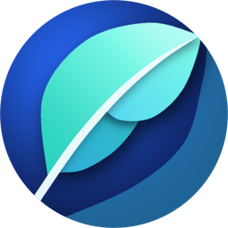

# 🌐 Lite Browser

<p align="center">
  
</p>

<p align="center">
  <b>Chromium Embedded Framework (CEF 154) 순수 Win32 C CAPI 기반의 초경량·초고속 하이브리드 데스크톱 웹 브라우저</b>
</p>

<p align="center">
  <a href="https://github.com/gregoryyoon/lite_browser/releases/latest"></a>
  <a href="https://github.com/gregoryyoon/lite_browser"></a>
  <a href="https://github.com/gregoryyoon/lite_browser"></a>
  <a href="https://github.com/gregoryyoon/lite_browser"></a>
  <a href="https://github.com/gregoryyoon/lite_browser"></a>
  <a href="https://github.com/gregoryyoon/lite_browser"></a>
  <a href="https://github.com/gregoryyoon/lite_browser"></a>
  <a href="https://github.com/gregoryyoon/lite_browser"></a>
  <a href="https://github.com/gregoryyoon/lite_browser"></a>
  <a href="LICENSE"></a>
</p>

---

## 📌 왜 Lite Browser인가요? (Why Lite Browser?)

현대의 웹 브라우저는 점점 더 무거워지고 있습니다. **Lite Browser**는 무거운 C++ 런타임 추상화 계층과 프레임워크 오버헤드를 과감히 걷어내고, **순수 C 언어(C11)**로 Chromium의 강력한 엔진(CEF)과 **Windows Win32 Native API**를 직결하여 탄생했습니다.

빠르고 쾌적한 반응성, 극상의 메모리 효율, 그리고 현대적인 **벤토 그리드(Bento Grid) 웹 UI**가 어우러져 일상적인 웹 서핑부터 전문적인 멀티태스킹까지 가장 가볍고 강력한 브라우징 경험을 선사합니다.

---

## ✨ 핵심 장점 및 주요 기능 (Key Highlights)

### ⚡ 1. 압도적인 성능과 극상의 효율 (Pure C11 & ThinLTO / LTCG)
- **Zero C++ Overhead**: C++ 가상 함수 테이블이나 프레임워크 래퍼 없이, 순수 C11 C API와 원자적 연산(`stdatomic.h`)으로 CEF 코어를 직접 제어하여 눈부신 시동 속도를 자랑합니다.
- **맞춤형 런타임 성능 모드**:
  - **실행 속도 우선 (Speed Priority)**: GPU 하드웨어 가속과 Direct3D 래스터화로 최고 성능의 웹 렌더링을 제공합니다.
  - **메모리 절감 우선 (Memory Saver Priority)**: 렌더러 프로세스 및 V8 힙을 최적화하여 저사양 PC나 노트북에서도 RAM 점유율을 30~50% 대폭 줄여줍니다.
- **Whole Program 최적화**: 배포 바이너리에 MSVC 링크 타임 코드 생성(`/LTCG`) 및 최대 속도 최적화(`/O2`)를 적용하여 타협 없는 실행 성능을 발휘합니다.

### 🍱 2. 세련된 벤토 그리드(Bento Grid) UI & 완벽한 다크/라이트 테마
- **감각적인 대시보드 디자인**: 설정(`lite://settings`), 북마크(`lite://favorites`), 다운로드(`lite://downloads`) 등 모든 내부 페이지에 심미성과 정보 밀도를 극대화한 **Bento Grid** 카드 UI를 적용했습니다.
- **화이트 플래시(White Flash) 제로**: Win32 네이티브 윈도우 배경 브러시와 DWM 다크 모드를 완벽히 연동하여, 창 전환이나 페이지 로딩 시 눈부심이 전혀 없는 쾌적한 다크 모드를 완성했습니다.
- **인라인 Lucide SVG 표준화**: 외부 웹폰트나 무거운 CDN 의존 없이 단독 오프라인에서도 아름답게 표시되는 순수 인라인 Lucide SVG 아이콘을 채택했습니다.

### ◫ 3. 프로페셔널 멀티태스킹: 듀얼 화면 분할 (Dual Split-View) & 자유로운 탭 관리
- **내장 듀얼 화면 분할 (Split-View)**: 별도 확장 프로그램 없이 클릭 한 번으로 단일 탭 내에서 좌/우 2개의 웹페이지를 동시에 비교하고 작업할 수 있습니다 (0.2 ~ 0.8 비율 자유 조절).
- **스마트 탭 매니지먼트**:
  - 탭이 많아져도 자동으로 균등 축소되어 한눈에 파악되는 모던 탭바.
  - 현재 보던 페이지 바로 옆에 새 탭을 열어주는 스마트 상대 위치 삽입.
  - 탭을 창 밖으로 드래그하면 즉시 독립 창으로 분리되고, 다른 창으로 드롭하면 매끄럽게 재결합되는 자유로운 탭 도킹.

### 🤖 4. 상시 대기 독립 도킹 AI 사이드패널 & 보안 볼트
- **작업 흐름을 방해하지 않는 AI 파트너**: 탭을 전환하거나 새 창을 열어도 대화 세션이 끊기지 않는 독립 네이티브 도킹 사이드패널을 제공합니다.
- **Claude & ChatGPT 유료 구독 모델 직접 연동**: 복잡하고 번거로운 종량제 API Key 발급 없이도, 기존에 사용 중인 **ChatGPT Plus/Pro** 및 **Claude Pro** 구독 계정을 원클릭으로 연동하여 최신 플래그십 AI 모델을 무제한 감각으로 활용할 수 있습니다. (Google Gemini 및 로컬 Ollama 모델도 완벽 지원)
- **Gemini 3.7 Flash 스마트 요약**: 긴 기사, 블로그, 심지어 YouTube 동영상 콘텐츠까지 5단계 스마트 분석 엔진으로 핵심만 명쾌하게 요약해 줍니다.
- **Windows DPAPI 보안 볼트**: 사용자 로그인 세션 토큰 및 API 키를 일반 파일에 평문 저장하지 않고, Windows OS 수준의 하드웨어 암호화(`CryptProtectData`)로 안전하게 격리 보호합니다.

### 🔄 5. 무음 백그라운드 자동 업데이트 (Zero-UAC Silent Updater)
- **방해 없는 무음 업데이트**: Chrome 및 VS Code 표준의 Per-User (`%LOCALAPPDATA%\Programs\LiteBrowser`) 아키텍처를 채택하여, **설치부터 업데이트까지 번거로운 UAC(사용자 계정 컨트롤) 승인 창이 전혀 뜨지 않습니다.**
- **백그라운드 스트리밍 & 원클릭 재시작**: 브라우징 중 백그라운드에서 유휴 대역폭으로 최신 패키지를 안전하게 다운로드 및 디지털 서명 검증(`WinVerifyTrust`)한 후, 상단 툴바 알림 뱃지 클릭 한 번으로 수 초 만에 최신 버전을 적용합니다.

### 🪟 6. Windows 10 / 11과의 매끄러운 셸 일체감
- **원클릭 기본 브라우저 연동**: 원클릭으로 Windows 기본 브라우저로 설정하고, 시스템 설정 변경 시 브라우저 내 상태 배지가 실시간으로 자동 갱신됩니다.
- **지능형 옴니박스 & 스마트 북마크**: 주소창에서 북마크, 웹 검색, 방문 기록을 통합 검색하고 `#` 태그 숏컷을 통해 필요한 페이지를 빠르게 찾습니다.
- **쾌적하고 깔끔한 브라우징 환경**: 백그라운드 다운로드 관리자(`lite://downloads`), 스마트 북마크 대시보드(`lite://favorites`) 등 매일의 웹 탐색에 최적화된 편의 기능을 제공합니다.

---

## 🏗️ 윈도우 레이아웃 및 아키텍처 (Architecture)

```text
+-----------------------------------------------------------------------------------------+
| Win32 Top-Level Window (Frameless, DWM Shadow, 0px Seamless Layout, Hit-Testing Subclass) |
|                                                                                         |
|  +-----------------------------------------------------------------------------------+  |
|  | [Top Child Browser] (Height: 72px * DPI Scale, Transparent Background)            |  |
|  | - Tab Bar: Multi-Tab, Auto-Shrinking, Relative Insertion, Drag-to-Separate       |  |
|  | - Navigation Bar: Back, Forward, Refresh, Omnibox, Split Button, Sidepanel Toggle |  |
|  +-----------------------------------------------------------------------------------+  |
|                                                                                         |
|  +-------------------------------------------------------------+-----+---------------+  |
|  | [Main Web Page / Split Left View]                           |     | [Docked AI    |  |
|  | (0px Seamless Fit / 2px Blue Selection Border in Split)     | 4px |  Sidepanel]   |  |
|  |                                                             | Res | (Independent  |  |
|  | ----------------- (4px Splitter Bar) ---------------------  | izer|  Native HWND, |  |
|  |                                                             | Bar |  Bento Chat & |  |
|  | [Split Right View (Optional)]                               |     |  DPAPI Vault) |  |
|  | (Edge-Style Rectangular Border, Shared Omnibox Sync)        |     |               |  |
|  +-------------------------------------------------------------+-----+---------------+  |
+-----------------------------------------------------------------------------------------+
```

---

## 🛠️ 기술 스택 (Tech Stack)

| 계층 (Layer) | 구성 요소 (Components) | 세부 기술 사양 (Specification) |
| :--- | :--- | :--- |
| **코어 브라우저 엔진** | CEF (Chromium Embedded Framework) | **CEF 154.0.34** (Chromium 154.0.8037.98), Pure C CAPI (`cefsimple_capi`) |
| **시스템 백엔드 언어** | C 언어 (MSVC Compiler) | **C11** (`/std:c11`, `/experimental:c11atomics`), Pure Win32 API, GDI, DWM |
| **빌드 최적화 (LTO)** | MSVC Whole Program Optimization | `/GL`, `/LTCG`, `/O2`, `/Oi`, `/Ot`, `/Gy`, `/GF`, `/OPT:REF`, `/OPT:ICF` |
| **보안 & 암호화** | Windows Security APIs | **Windows DPAPI** (`CryptProtectData`), Authenticode **SHA-256 + RFC 3161 Timestamp** |
| **자동 업데이트** | Zero-UAC Silent Updater Engine | **WinHTTP 백그라운드 스트리밍**, `WinVerifyTrust` 전자 서명 검증 |
| **웹 프론트엔드 UI** | Chrome Controls & Dashboards | **HTML5, Vanilla CSS3 (Bento Grid Tokens), ES6+ JavaScript, Inline Lucide SVG** |
| **빌드 시스템** | CMake & Visual Studio | CMake 3.19+, Visual Studio 2022/2026 MSVC C/C++ x64 |
| **배포 패키징 도구** | NSIS (Nullsoft Scriptable Install System) | **NSIS 3.x 64-bit Unicode (Per-User `%LOCALAPPDATA%\Programs\LiteBrowser`, Zero-UAC)** |

---

## 🚀 빠른 시작 (Getting Started)

### 1. 다운로드 및 설치 (Download)
GitHub 최신 릴리즈 페이지에서 공식 인스톨러를 다운로드하여 바로 실행할 수 있습니다:
- **[최신 버전 다운로드 (GitHub Releases)](https://github.com/gregoryyoon/lite_browser/releases/latest)**
- Authenticode SHA-256 디지털 서명 및 DigiCert RFC 3161 공인 타임스탬프가 적용되어 있어 안전하게 설치할 수 있습니다.

---

### 2. 소스코드 빌드 (Build from Source)

#### 전제 조건 (Prerequisites)
- Windows 10 또는 Windows 11 (64-bit)
- Visual Studio 2022 또는 2026 (C/C++ MSVC x64)
- CMake 3.19 이상

#### 빌드 명령어 (PowerShell)
```powershell
# Debug 모드 빌드 (개발 및 디버깅용)
cmake --build cef_binary_154.0.34\build --config Debug --target cefsimple_capi

# Release 모드 빌드 (LTCG 최적화 적용 배포용)
cmake --build cef_binary_154.0.34\build --config Release --target cefsimple_capi
```

빌드가 완료되면 실행 파일이 아래 경로에 생성됩니다:
- `cef_binary_154.0.34\build\tests\cefsimple_capi\Release\lite_browser.exe`

---

## 📂 프로젝트 구조 (Project Structure)

```text
lite_browser\
├── README.md                                  # GitHub 프로젝트 대표 안내 문서
├── LICENSE                                    # BSD 3-Clause 오픈소스 라이선스
├── installer.nsi                              # NSIS 64-bit Per-User Zero-UAC 인스톨러 스크립트
├── scripts\                                   # 빌드, 서명, 배포 자동화 파이프라인
│   ├── create_github_release.ps1              # GitHub Release 자동 생성 및 패키지 배포
│   └── sign_installer.ps1                     # signtool 기반 SHA-256 + DigiCert RFC 3161 코드 서명기
├── ui\                                        # 벤토 그리드 Web UI 에셋 (HTML5 / CSS3 / ES6+)
│   ├── index.html / style.css / app.js        # 상단 프레임리스 탭바 & 지능형 주소창 컨트롤 UI
│   ├── settings.html / css / js               # lite://settings 전용 설정 대시보드
│   ├── manager.html / css / js                # lite://favorites 차세대 북마크 대시보드
│   ├── downloads.html / css / js              # lite://downloads 다운로드 관리자 대시보드
│   ├── sidepanel.html / css / js              # 독립 도킹 AI 에이전트 사이드패널 UI
│   └── theme.js                               # 벤토 그리드 다크/라이트 테마 전역 브로드캐스트 엔진
├── cef_binary_154.0.34\                       # CEF 154.0.34 바이너리 배포본 (Chromium 154)
│   └── tests\cefsimple_capi\                  # 순수 C11 C API 메인 백엔드 소스 디렉터리
│       ├── version.h                          # 브라우저 전역 단일 버전 관리 (SSOT)
│       ├── cefsimple_win.c                    # Win32 메인 진입점 (wWinMain), 로캘 감지, root_cache 격리
│       ├── simple_updater.c / h               # 백그라운드 무음 업데이트 스트리밍 및 WinVerifyTrust 검증
│       ├── default_browser.c / h              # Windows 10/11 기본 브라우저 레지스트리 연동
│       ├── simple_optimization.c / h          # 속도 우선 vs 메모리 절감 런타임 최적화 엔진
│       ├── simple_app.c / h                   # Win32 메인 프로시저, 서브클래싱, 0px 심리스 레이아웃
│       ├── simple_handler.c / h               # IPC 액션 라우터, 탭 제어, 옴니박스 동기화
│       ├── simple_life_span_handler.c         # 팝업 가로채기 및 UAF 방지 비동기 수명 주기 가드
│       ├── simple_download_handler.c / h      # CEF 다운로드 추적, 자동 중복 순번 및 상태 동기화
│       └── simple_vault.c / h                 # Windows DPAPI (CryptProtectData) 보안 볼트
└── docs\                                      # 프로젝트 문서 및 에셋
    ├── logo.png                               # 256x256 HiDPI 투명 브라우저 로고
    └── walkthrough.md                         # 전체 기능 및 개발 마일스톤 통합 기술 보고서
```

---

## 📄 라이선스 (License)

본 프로젝트는 Chromium 및 CEF (Chromium Embedded Framework) 오픈소스 라이선스 규정을 준수합니다.

- **Chromium / CEF**: [BSD 3-Clause License](https://opensource.org/licenses/BSD-3-Clause)
- **Lite Browser Source Code**: Copyright (C) 2026 Gregory Yoon. All rights reserved.
- 자세한 라이선스 조항은 [`LICENSE`](LICENSE) 및 [`cef_binary_154.0.34/LICENSE.txt`](cef_binary_154.0.34/LICENSE.txt)를 참조하십시오.
